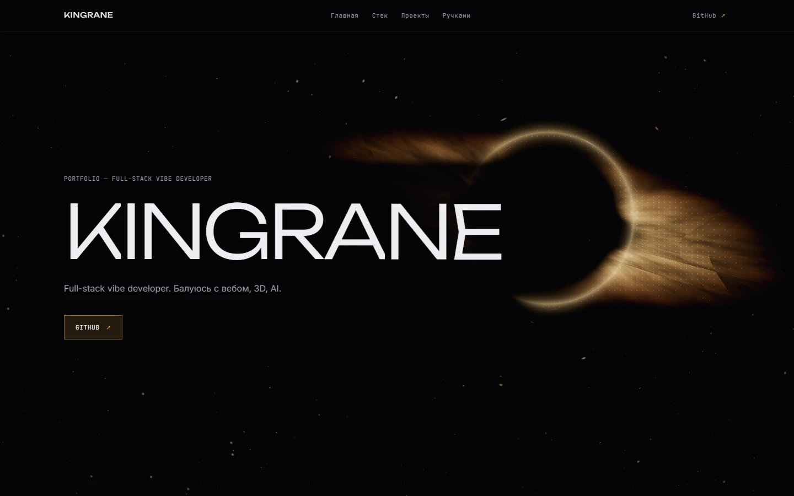
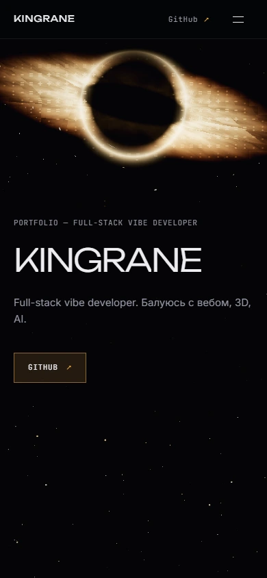
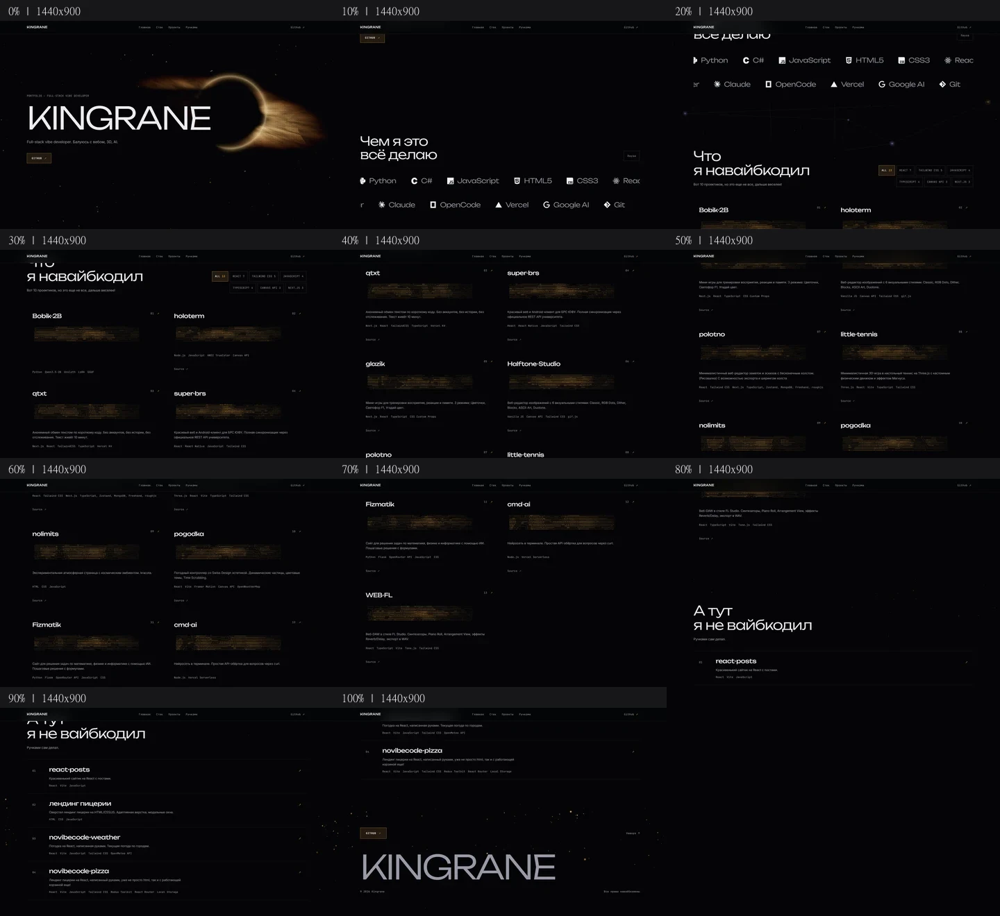
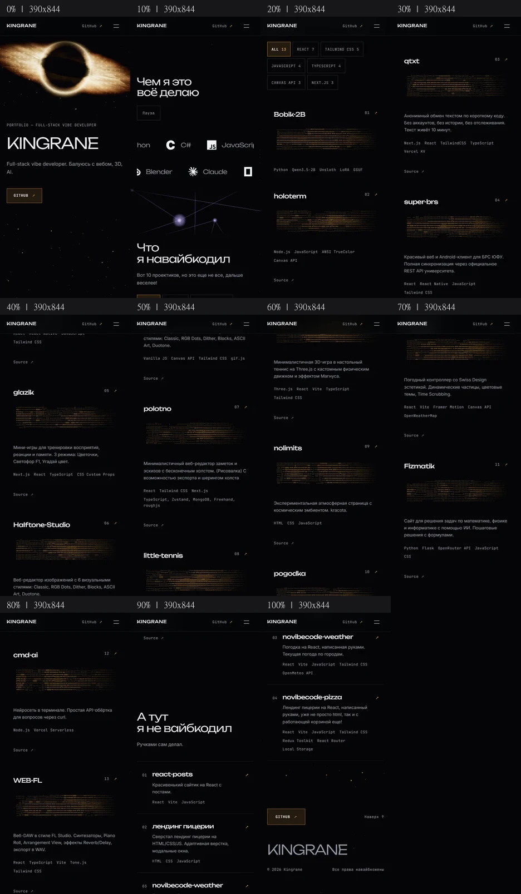
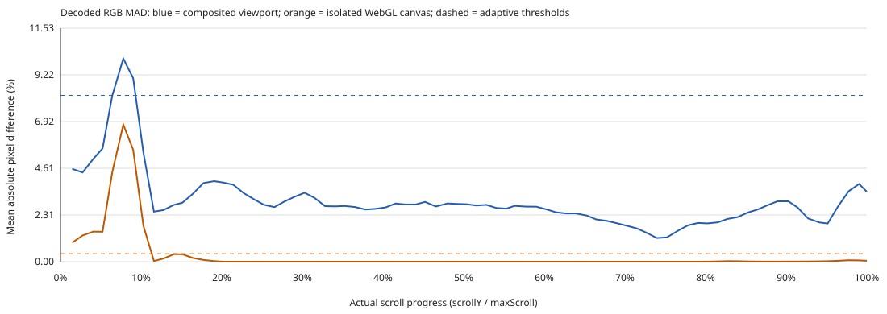
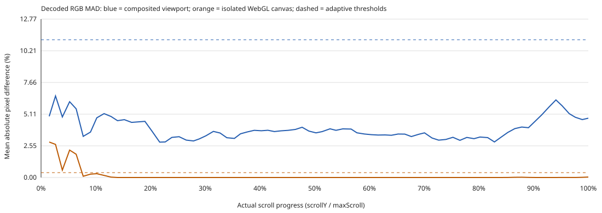

# Фаза A — зачистка, честность и основа непрерывной сцены

## Найденные причины серых пятен и швов в v1

1. **Серый фон генерировал сам шейдер, а не bloom.** В `330fbda:src/components/webgl/shaders/blackhole.ts` пустое пространство начиналось с линейного RGB `(0.010, 0.010, 0.018)`. К нему прибавлялся только положительный крупномасштабный `fbm(p * 2.4)` с фиолетовым оттенком. После sRGB-вывода это уже заметный серо-фиолетовый фон, примерно `#1d1d29`–`#2b2a3d`, а не почти чёрный. Низкочастотный клеточный шум давал крупные пятна. `pow(col, 0.95)` дополнительно осветлял тени, несмотря на комментарий про повышение контраста. Положительная пыль, база и это осветление удалены, не закрыты CSS-оверлеем.
2. **Косая граница была краем геометрии.** «Fullscreen»-шейдер рисовался на плоскости в мировых координатах на `z=-8`. При движении камеры её край попадал в экран; roll камеры делал границу наклонной. В v1 это происходило примерно между 1,077% и 15,44% прокрутки. Теперь quad покрывает экран в clip space независимо от камеры.
3. **ASCII-атлас читался вверх ногами.** При стандартном `CanvasTexture.flipY=true` пустой индекс 0 выбирал `%`, индекс 1 — `@`, а индексы 2–7 — пустые ячейки второй строки. Вместо плавной рампы плотности получались неверные яркие/пустые клетки. `flipY=false` согласован с UV шейдера; mipmaps у атласа выключены.
4. **Цветовой тракт не был согласован.** Composer не имел явного HDR tone-mapping; прозрачность старой плоскости и цветной fallback давали разные подложки. Bloom-пасса в v1 не было, двойная gamma при проверке установленного `postprocessing` не подтвердилась. Сейчас порядок явный: linear HalfFloat → ASCII → ACES → IGN-дизеринг → один sRGB-вывод. Фон и fallback согласованы с `#050507`.
5. **Дополнительные шейдерные дефекты:** шум по непериодическому `atan` давал разрыв на ветви угла; несколько `smoothstep` имели обратный порядок границ с неопределённым результатом GLSL. Угловые координаты стали периодическими, границы исправлены.

Контроль пустой области hero, 90×190 px: медиана и p95 максимального RGB-канала **7/255**, что соответствует тени `#050507`. Это отдельный замер, не оценка всего освещённого диска.

## Что сделано в A

- Удалены HUD, фейковые числа/статусы, UTC, статистика hero, служебный футер, переключатель режимов и его localStorage, пасхалки, прелоадер и hover-scramble. Старые неиспользуемые компоненты в корне `src/components/` не переписывались.
- Возвращены оригинальные тексты из `main` и все 15 исходных описаний, теги и ссылки проектов. Оригинальные «10» и «еще» сохранены дословно; фильтры отдельно считают реальные данные. Проекты Bobik-2B и holoterm остаются, их неподтверждённые описания скрыты и записаны в [`COPY_TO_APPROVE.md`](../../COPY_TO_APPROVE.md).
- Сохранены шрифты; информативное моно ≥11 px, tracking ≤0,08 em. Исправлены висящие короткие слова заголовков. UI-акценты — янтарь и небольшой ирис.
- Один fixed WebGL canvas, HTML-контент над ним, `src/scene/timeline.ts` с непрерывной интерполяцией. Ключи калибруются по реальной высоте секций после layout/fonts, включая длинный мобильный список и короткий футер.
- Общие `data-reading` зоны затемняют/разрежают фон. Видимые прямоугольники объединяются до восьми uniforms, а не отбрасываются по DOM-порядку; fixed-шапка защищена отдельно. После изменения layout обновляется и scroll-progress.
- Появление секций стало обратимым scroll-scrub; текст не теряет непрозрачность в зоне чтения. Старые миры подключены к общей шкале, без самостоятельных резких переключений.
- Убраны дубли стека; две монохромные ленты имеют паузу и reduced-motion раскладку. Шесть наиболее частых тегов + ALL переносятся, счётчики вычисляются из данных.
- Native-dialog мобильное меню: focus trap, Escape, возврат фокуса и блокировка прокрутки. Reduced-motion / Save-Data / no-WebGL сохраняют рабочий HTML без живого WebGL. На touch нет hover-only информации.
- GPU-ресурсы постобработки создаются и освобождаются в одном `useEffect`, включая StrictMode replay. OG-картинка больше не содержит фейковых подписей v1.

**Новая зависимость:** Playwright добавлен только в devDependencies для воспроизводимых скриншотов, проверки геометрии, контраста и пиксельных швов. Других зависимостей в A не добавлялось.

## Самостоятельный визуальный просмотр: что ещё не так

Просмотрены все 22 контрольных кадра, оба контактных листа, полноразмерные hero/мобильные переносы, графики и соседние canvas-кадры 005–008 вокруг максимального desktop MAD.

- **Дыра ещё старая:** радиальные полосы заметны, оптика не физическая, композиция во время падения пока не финальная. Новая интеграция лучей и постер — фаза B.
- **Проекты пока однотипны:** сохранена промежуточная сетка со статичными процедурными превью; это не обещанный индекс + sticky-панель. Bobik/holoterm выглядят пустее из-за скрытого неподтверждённого описания. Уникальные ASCII-сцены и окончательная раскладка — C.
- **Сад разрежен:** текущие цветы ещё не новые ирисы/космеи/ромашки и не выразительный передний план. Полная замена геометрии и связей с handmade-проектами — D.
- **Футер пока типографический**, не из упругих ASCII-частиц. Это E.
- Прямоугольных пятен и косой плоскостной границы на проверенных кадрах не обнаружено; явного бандинга не видно. Это вывод по указанным кадрам, не гарантия для любого дисплея/GPU.

## Проверки и реальные результаты

Дата: **15.11.2026**. Production static export, `http://127.0.0.1:4173/portfolio/`, Chrome **157.0.8103.52**. Машиночитаемая сводка: [`evidence.json`](evidence.json).

| Проверка | Результат |
| --- | --- |
| `npm run build` | Статическая сборка успешна, включая TypeScript новых QA-скриптов |
| `npm run lint` | 0 ошибок; 3 прежних warnings в legacy `conveyor-belt.tsx` / `scramble-text.tsx` |
| `npx tsc --noEmit --incremental false` | Успешно |
| `scripts/check-scene.ts` | 15 оригинальных проектов точны; конечность и непрерывность timeline; desktop short-footer и mobile calibration проходят |
| Скриншоты | **22/22**: 1440×900 и 390×844, 0–100% через 10% |
| Геометрия | **55/55** точек на ширинах 375/390/768/1440/1920; **0** ошибок |
| Контраст | **530** проверок текстовых фрагментов; **0** провалов/неподдерживаемых случаев; минимум **6,459:1** при требовании 4,5:1 |
| Пиксельные швы | По **81** кадру на desktop/mobile; покрытие достаточно; **0** подозрительных canvas- и HTML-only всплесков |
| Runtime/network | **0** ошибок |
| Fallback / touch | Reduced-motion, Save-Data, no-WebGL и touch проходят; меню focus/Escape/lock/anchor и фильтры работают |
| Lighthouse / FPS / CLS | **Не измерялись**; оценки v1 не выдаются за v2 |

**Метод контраста.** Проверяется вычисленный цвет текста с накопленной opacity относительно пикселей отдельного снимка с прозрачной заливкой текста, но сохранённой геометрией и фоном. Координаты — реальные Range-строки. Критерий — худший замеренный пиксель, не усреднение или p05. Только HTML-ленты остановлены на время парного замера, чтобы иконки не попадали под устаревшие координаты текста; WebGL остаётся живым. Два снимка мира не являются одним и тем же моментом анимации, поэтому это выборочный тест плюс визуальный просмотр, не исчерпывающая гарантия для всех кадров.

**Метод геометрии.** Краевые слова явно заданной бегущей ленты сохранены отдельно как intentional ticker clipping — 78 кандидатов. Исключение не распространяется на вертикальное обрезание, контейнер вне viewport, фильтры или другие `overflow-hidden` блоки. Естественный вход/выход документа за верх/низ viewport не считается ошибкой вёрстки.

**Метод швов.** Непрерывная прокрутка с постоянной скоростью по времени; отдельно сняты composited viewport и canvas с временно скрытым HTML, но сохранёнными DOM-прямоугольниками. RGB MAD соседних полноразмерных декодированных кадров нормирован на 255. Подозреваемый скачок должен превышать и глобальный, и локальный robust-порог; затем проверяется глазами. Синяя линия — весь viewport, оранжевая — canvas; пунктир на графике показывает глобальный порог, локальные пороги записаны в JSON.

Максимальный canvas MAD **не нулевой**: desktop **6,767%** около 7,79% scroll; mobile **2,859%**. Desktop-кадры 005–008 показывают расширение/затухание старой дыры, а не пересечение края плоскости. Эти изменения не вычеркнуты: они видны на графиках и в `largestDeltas`.

Единственный console warning браузера — `THREE.Clock` deprecated из Fiber/Three; runtime errors нет. При установке npm сообщал 17 vulnerabilities; `npm audit fix` без отдельного согласования не запускался.

## Скриншоты

### Hero





### Все контрольные точки





Контактные листы и hero WebP — сжатые превью. Для проверки пикселей сохранены **22 исходных PNG**:

| Scroll | 1440×900 | 390×844 |
| --- | --- | --- |
| 0% | [PNG](screenshots/1440x900/000.png) | [PNG](screenshots/390x844/000.png) |
| 10% | [PNG](screenshots/1440x900/010.png) | [PNG](screenshots/390x844/010.png) |
| 20% | [PNG](screenshots/1440x900/020.png) | [PNG](screenshots/390x844/020.png) |
| 30% | [PNG](screenshots/1440x900/030.png) | [PNG](screenshots/390x844/030.png) |
| 40% | [PNG](screenshots/1440x900/040.png) | [PNG](screenshots/390x844/040.png) |
| 50% | [PNG](screenshots/1440x900/050.png) | [PNG](screenshots/390x844/050.png) |
| 60% | [PNG](screenshots/1440x900/060.png) | [PNG](screenshots/390x844/060.png) |
| 70% | [PNG](screenshots/1440x900/070.png) | [PNG](screenshots/390x844/070.png) |
| 80% | [PNG](screenshots/1440x900/080.png) | [PNG](screenshots/390x844/080.png) |
| 90% | [PNG](screenshots/1440x900/090.png) | [PNG](screenshots/390x844/090.png) |
| 100% | [PNG](screenshots/1440x900/100.png) | [PNG](screenshots/390x844/100.png) |

### Графики пиксельных различий





Полный локальный QA-архив, включая снимки без текста, пары seam-кадров, checks/events/summary и smoke JSON: `C:\Users\REDMI\AppData\Local\Temp\opencode\portfolio-qa-phase-a`.

## Как повторить

После `npm run build` разместить содержимое `out/` на локальном статическом сервере **под `/portfolio/`**, поскольку production-сборка использует этот basePath. QA-скрипт не запускает сборку или сервер самостоятельно. Из корня репозитория, PowerShell:

```powershell
$env:QA_URL = "http://127.0.0.1:4173/portfolio/"
$env:QA_CHROME = "C:\Program Files\Google\Chrome\Application\chrome.exe"
$env:QA_OUT = "C:\Users\REDMI\AppData\Local\Temp\opencode\portfolio-qa-phase-a"
node --experimental-strip-types scripts/check-scene.ts
node --experimental-strip-types scripts/qa-smoke.ts
node --experimental-strip-types scripts/qa.ts
```

Node при этом запуске: 24.14.0. `QA_OUT` можно заменить, чтобы не перезаписать предыдущий архив. После автоматического прохода нужен ручной просмотр кадров; скрипт честно оставляет статус `automated-checks-passed-manual-review-required`.

## Граница фазы и следующий шаг

**Завершена только A.** Основы ASCII/HDR введены здесь для устранения корневых артефактов; это не заявление о завершении художественной части B. Fallback сейчас — читаемая почти чёрная поверхность, не окончательный статичный постер. Дыра, проектные сцены, цветы и ASCII-футер ещё не заменены по брифу.

Следующая фаза **B: Hero и падение** — интеграция лучей, линзированный диск и звёзды, доплеровское усиление, финальная композиция с защищённым заголовком, настройка ASCII-маски и качественный постер. C–E не начинались. Работа остановлена перед B до подтверждения пользователя.

Ветка `redesign`; `main` не изменялся, пуша нет. V1 сохранён в `330fbda`. Пользовательские `designtest.md`, `designtest2.md` и `references/` не включаются в коммит A.
